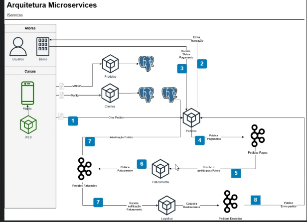

# 🛒 iCompras Serviços

### Projeto de estudo — Spring Boot + Apache Kafka

Projeto desenvolvido para estudar a construção de aplicações distribuídas utilizando **Spring Boot** e **Apache Kafka**, explorando a comunicação assíncrona entre serviços e a arquitetura baseada em eventos.

📚 **Curso de referência:** [Spring Boot e Kafka — Udemy](https://www.udemy.com/course/spring-boot-kafka)

---

## 📐 Arquitetura do Projeto

A imagem abaixo representa a arquitetura utilizada como referência para o desenvolvimento e estudo da aplicação.

---

## 🎯 Objetivos do Projeto

- Estudar o desenvolvimento de aplicações com Spring Boot.
- Compreender os conceitos fundamentais do Apache Kafka.
- Explorar a comunicação assíncrona entre serviços.
- Entender o fluxo de mensagens em uma arquitetura distribuída.
- Praticar a integração entre componentes utilizando mensageria.

---

## 🛠️ Tecnologias

---

## 📚 Conteúdo de Estudo

- Desenvolvimento backend com Java e Spring Boot.
- Fundamentos de mensageria com Apache Kafka.
- Comunicação entre serviços.
- Processamento e troca de mensagens.
- Conceitos de arquitetura distribuída.

---

## 🚀 Objetivo de Aprendizado

Este projeto faz parte da minha jornada de aprendizado em desenvolvimento backend, com foco em aplicações distribuídas, integração entre serviços e processamento de mensagens.

A proposta é aplicar os conceitos apresentados no curso, experimentar soluções e aprofundar os conhecimentos no ecossistema Java.

---

---

## 🔗 Referência

[Spring Boot e Kafka — Curso na Udemy](https://www.udemy.com/course/spring-boot-kafka)
